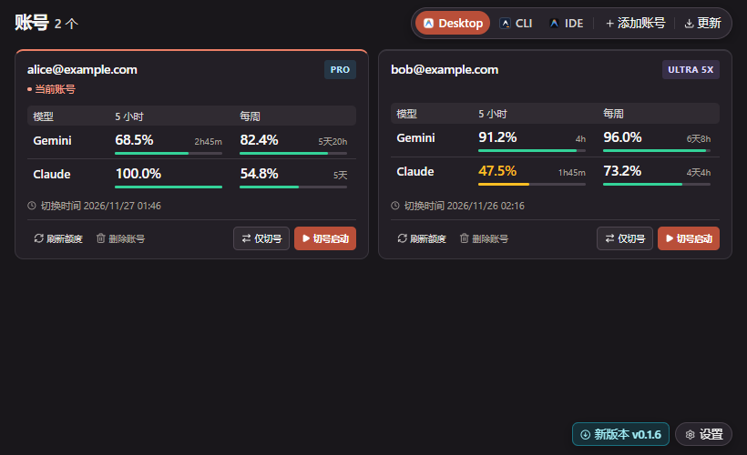

<div align="center">

# Agy Shift

A lightweight **Antigravity** account switcher and quota tracker for Windows. All accounts and credentials stay strictly on your local computer with zero external relay servers.

<p>
  <a href="README.md"></a>
  <a href="README.en.md"></a>
</p>

<p>
  <a href="https://github.com/KeS1Ke/agy-shift/releases/latest"></a>
  <a href="https://github.com/KeS1Ke/agy-shift/releases/latest"></a>
  <a href="https://creativecommons.org/licenses/by-nc-sa/4.0/"></a>
</p>

**[Download Installer for Windows x64](https://github.com/KeS1Ke/agy-shift/releases/latest)**

</div>



> Forked and streamlined from [`jlcodes99/cockpit-tools`](https://github.com/jlcodes99/cockpit-tools), focused specifically on Antigravity on Windows, retaining upstream attribution under [CC BY-NC-SA 4.0](https://creativecommons.org/licenses/by-nc-sa/4.0/).

---

## Features

- **Direct Client & Account Switching**: Switch directly between `Desktop`, `CLI`, and `IDE` from the top toolbar. Each account card provides dedicated **Switch Only** (`仅切号`) and **Switch & Launch** (`切号启动`) buttons.
- **Zero-OAuth Local Import**: No Google OAuth client configuration required. Sign in through the official Antigravity desktop app or IDE, then import the local session directly into Agy Shift. Legacy tool migration and batch JSON import are also supported.
- **1-Decimal Quota Tracking**: Displays account tiers (`PLUS`, `PRO`, `ULTRA 5X`, `ULTRA 20X`), 5-hour and weekly quotas for Gemini and Claude with 1-decimal percentage precision, reset countdowns, last switch timestamps, and per-account refresh.
- **Auto Update & Notification Badge**: Toggle **Auto check updates** and **Auto download updates** in Basic Settings. When a newer release is available, a pale-cyan badge appears next to the bottom-right Settings button and verifies packages against the embedded public key before installing.
- **Custom Launch Paths**: Configure custom executable paths independently for the Desktop app, IDE, and CLI, or restore auto-detection at any time.
- **Instant Tray Reopen**: Minimizing to the system tray hides the main window in low-memory mode so clicking the tray icon restores the UI instantly without white-screen flashing.
- **Local-First Privacy**: All accounts, tokens, and quota caches remain exclusively on your own machine—nothing is sent to developer or third-party relay servers.

---

## Zero-OAuth Local Import

Agy Shift works **out of the box without any Google OAuth credentials**:

1. Sign in to your account inside the official Antigravity desktop app or IDE.
2. Open Agy Shift and click **+ Add Account → Local Import** to read the local login state and sync quota into your account pool.
3. If a cached local access token expires later, switch to that account and open Antigravity so the official client renews it locally; Agy Shift automatically picks up the refreshed local token on the next quota check.

---

## Data Directory & Isolation

Agy Shift isolates its data directory from upstream Cockpit Tools by default so trying it out never overwrites existing data:

- **Development (`Debug` / `AGY_SHIFT_PROFILE=dev`)**: defaults to `~/.agy_shift_dev` (preference file: `~/.agy_shift_dev-data-root.json`).
- **Release**: defaults to `~/.agy_shift` (preference file: `~/.agy_shift-data-root.json`).
- **Environment override**: set `AGY_SHIFT_DATA_DIR` (or compatible `COCKPIT_TOOLS_DATA_DIR`) to use a custom directory.

---

## Build from Source

Prerequisites: Node.js 18+, npm 9+, and a Rust toolchain.

```bash
# Install frontend dependencies
npm install

# Run TypeScript typecheck
npm run typecheck

# Start Tauri dev mode
npm run tauri:dev

# Build standalone release executable
npm run build:exe

# Build installer
npm run build:nsis

# Run Rust unit tests
npm run test:rust
```

> In-app updates fetch the release manifest from GitHub Releases and verify package signatures against the embedded public key. You can also open the GitHub Releases page directly from the update dialog to download manually.

---

## License

Licensed under [CC BY-NC-SA 4.0](https://creativecommons.org/licenses/by-nc-sa/4.0/) (Attribution-NonCommercial-ShareAlike 4.0 International), derived from [`jlcodes99/cockpit-tools`](https://github.com/jlcodes99/cockpit-tools).

- **Allowed**: Personal, educational, research, and non-commercial modification and redistribution with attribution to `jlcodes99/cockpit-tools` under the same license.
- **Not allowed**: Commercial use without explicit written permission from the upstream author.
