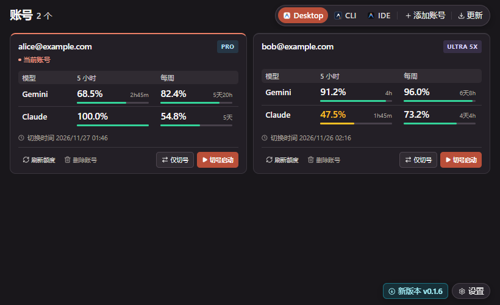

<div align="center">

# Agy Shift

Windows 轻量级 **Antigravity** 账号切换与配额管理工具。所有账号与登录凭据均仅保存在用户本机，不经过任何外部中转服务。

<p>
  <a href="README.md"></a>
  <a href="README.en.md"></a>
</p>

<p>
  <a href="https://github.com/KeS1Ke/agy-shift/releases/latest"></a>
  <a href="https://github.com/KeS1Ke/agy-shift/releases/latest"></a>
  <a href="https://creativecommons.org/licenses/by-nc-sa/4.0/deed.zh-hans"></a>
</p>

**[下载 Windows x64 安装包](https://github.com/KeS1Ke/agy-shift/releases/latest)**

</div>



> 本项目基于 [`jlcodes99/cockpit-tools`](https://github.com/jlcodes99/cockpit-tools) 进行 Fork 与精简裁剪，剥离了其他平台与多开实例模块，仅保留 Windows 下的 Antigravity 核心能力，并依据原项目许可证保留对 `jlcodes99/cockpit-tools` 的 [CC BY-NC-SA 4.0](https://creativecommons.org/licenses/by-nc-sa/4.0/deed.zh-hans) 署名与开源条款。

---

## 核心功能

- **一键切换客户端与账号**：顶部工具栏直接切换 `Desktop`、`CLI`、`IDE` 目标客户端；每张账号卡片提供独立的 **「仅切号」** 与 **「切号启动」** 按钮，一步到位。
- **免 OAuth 本机导入**：无需配置任何 Google OAuth 客户端凭据，在官方 Antigravity 桌面端或 IDE 登录后，点击「+ 添加账号 → 本机导入」即可直接读取本机登录态，也支持旧版工具数据和 JSON 批量迁移。
- **高精度额度查看**：账号卡片区分 `PLUS`、`PRO`、`ULTRA 5X` 和 `ULTRA 20X`，展示 Gemini 与 Claude 的 5 小时及每周剩余额度（保留一位百分比小数）、重置倒计时、最近切换时间，并支持单账号刷新。
- **自动更新与提示**：在右下角「基础设置」中可选开启 **「自动检测更新」** 与 **「自动下载更新包」**；发现新版本时，右下角「设置」旁会以淡青色方框显示最新版本号，点击即可经更新公钥验签后直接安装升级。
- **自定义启动路径**：在「基础设置」中可分别为桌面端、IDE 和 CLI 指定可执行文件路径，也可随时恢复自动探测。
- **托盘常驻秒开**：收进系统托盘时隐藏主窗口并切入低内存模式，点击托盘图标可秒开恢复界面且无白屏闪烁。
- **隐私与本地安全**：所有账号、Token 与配额缓存均只保存在用户自己的电脑本地，不向开发者或任何第三方中转服务器上传数据。

---

## 免 OAuth 本机接管说明

Agy Shift 默认**不需要配置任何 Google OAuth 凭据**：

1. 在官方 Antigravity 桌面端 / IDE 正常登录账号；
2. 打开 Agy Shift，点击 **「+ 添加账号 → 本机导入」**，直接读取本机已有登录凭据与配额并加入账号池；
3. 当某个账号的本地访问令牌过期时，切回该账号并打开官方 Antigravity 客户端自动续期后，Agy Shift 会在刷新配额时自动同步最新本机令牌。

---

## 数据目录与隔离策略

Agy Shift 默认与原版 Cockpit Tools 数据目录隔离，避免首次试用时互相覆盖：

- **开发模式（Debug / `AGY_SHIFT_PROFILE=dev`）**：默认使用 `~/.agy_shift_dev`，偏好文件为 `~/.agy_shift_dev-data-root.json`。
- **正式版（Release）**：默认使用 `~/.agy_shift`，偏好文件为 `~/.agy_shift-data-root.json`。
- **环境变量覆盖**：可通过 `AGY_SHIFT_DATA_DIR`（或兼容变量 `COCKPIT_TOOLS_DATA_DIR`）显式指定数据目录。

---

## 从源码构建

前置环境：Node.js 18+、npm 9+ 与 Rust 工具链。

```bash
# 安装前端依赖
npm install

# 前端类型检查
npm run typecheck

# 启动开发模式
npm run tauri:dev

# 编译 Release 可执行文件
npm run build:exe

# 构建安装包
npm run build:nsis

# 运行 Rust 单元测试
npm run test:rust
```

> 应用内更新会从 GitHub Releases 拉取更新清单并使用内置公钥校验签名，也可在更新弹窗中直接打开 GitHub 发布页手动下载安装包。

---

## 许可证

本项目遵循 [CC BY-NC-SA 4.0](https://creativecommons.org/licenses/by-nc-sa/4.0/deed.zh-hans)（署名-非商业性使用-相同方式共享 4.0 国际）协议，派生自 [`jlcodes99/cockpit-tools`](https://github.com/jlcodes99/cockpit-tools)。

- **允许**：在保留原始署名（`jlcodes99/cockpit-tools`）及相同协议的前提下，用于个人学习、研究与非商业用途的修改与分发。
- **禁止**：任何未获原项目作者书面授权的商业使用。
